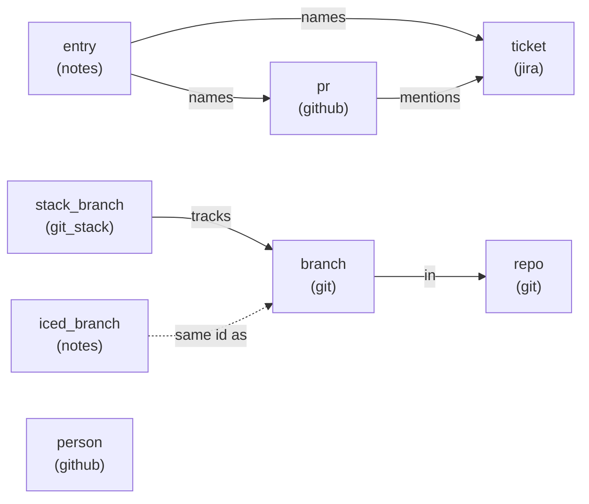
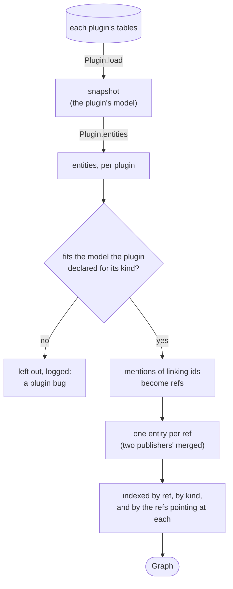
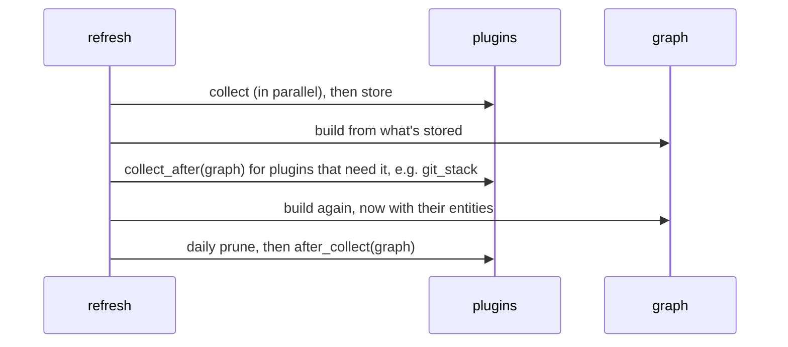
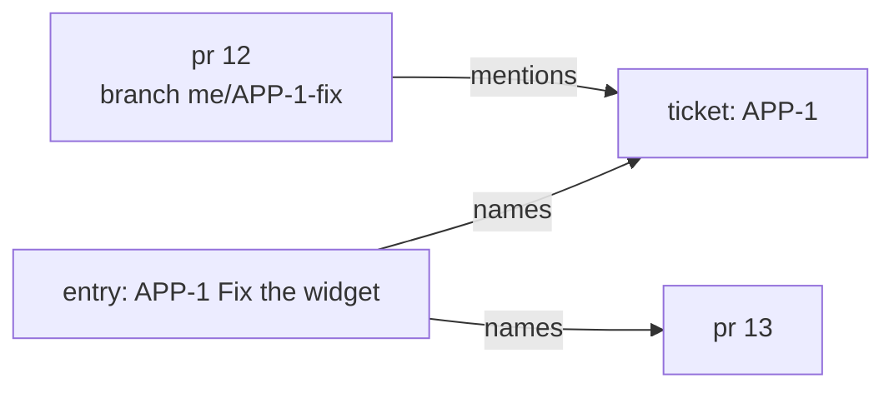

# The entity graph

Plugins never import each other or read each other's config, snapshots or tables. What one
plugin knows that another needs goes through the graph: each plugin publishes **entities**
(PRs, branches, tickets, work entries, ...), and every plugin reads the others' from it.
This page is about how the graph works; [entities.md](entities.md) is the contract, kind by
kind, and [plugins.md](plugins.md) draws who publishes and reads what.

The graph lives in memory and is never stored. Core builds it from what the plugins have
kept in their tables, whenever it's needed: for every page load, button, plugin page and
`mfd <plugin>` command, and twice during a refresh. Building it is cheap: no network, only
the plugins' own tables.

## Entities and refs

An entity is named by a **ref**: a kind (`pr`, `branch`, `ticket`, ...) and an id within it
(a PR's URL, `<repo dir>\t<branch>`, a ticket's key). Besides its ref it has a title, an
optional URL and state, the refs it points at, and attributes:

```python
class Entity(Model):
    ref: Ref  # e.g. Ref(kind="pr", id="https://github.com/acme/widgets/pull/12")
    title: str
    url: str | None
    state: str | None  # "open", "merged", a ticket's status, ...
    refs: list[Ref]  # what it points at
    mentions: list[str]  # text that may name linking entities, see below
    attrs: dict[str, JsonValue]
```

Refs are how entities relate. They can point at an entity no plugin publishes (a ticket
key when Jira isn't set up, a branch git has deleted); the ref still links what names it.
Today's kinds and the refs between them:



`iced_branch` doesn't point at its branch; it shares the branch's id, so a consumer asks
`graph.get("iced_branch", branch_id)`. `person` stands alone: core finds `me` among them, and
slack reads their emails.

## How it's built



1. Each enabled plugin's `load` reads what its last refresh kept, and its `entities` turns
   that (and its other tables) into entities.
2. A plugin declares the kinds it publishes in `kinds`, each with a model of its
   attributes, and builds its entities' attributes from those models (with `attrs` from
   `move_forward.graph`). Core
   checks every entity against its kind's model; one that doesn't fit is left out and
   logged, so the page goes on without it.
3. Text an entity `mentions` that matches a linking kind's id pattern becomes a ref to it
   (see [related entities](#related-entities)).
4. Two plugins publishing the same ref would be merged, the first plugin's fields winning;
   no plugin does any more (git_stack publishes its own `stack_branch` instead of adding to
   git's `branch`), and the merging is due to go.
5. The graph indexes entities by ref, by kind, and by the refs pointing at each, for the
   lookups below.

During a refresh the graph is built twice:



## Reading it

```python
graph.get("pr", url)  # one entity, or None
graph.of_kind("pr")  # every entity of a kind
graph.related(ref, "entry")  # see below
graph.named("APP-1: fix it")  # the linking entities a text names, see below
graph.url_for("ticket", "APP-1")
```

### Through a view

A consumer doesn't read `entity.attrs` directly. It declares the fields it uses as a small
model of its own, a **view**, and reads entities through it:

```python
class _PrView(Model):
    """What jira reads of a `pr` (github's)."""

    id: str
    url: str | None = None
    state: str | None = None
    number: int
    draft: bool
    mine: bool


for pr in graph.view_related(ticket_ref, "pr", _PrView):
    if pr.mine and not pr.draft:
        ...
```

`view(kind, View)`, `view_one(kind, id, View)` and `view_related(ref, kind, View)` validate
each entity's `id`, `title`, `url`, `state` and attributes against the view. If a publisher
renames or drops an attribute a consumer relies on, the view raises, and the consumer's
tests fail, instead of `attrs.get` quietly giving `None` and the page quietly showing less.
A view lists only what its consumer reads, so publishers can add attributes freely.

### Related entities

Some kinds stand for a unit of work and link what's about it. A plugin declares them in
`linking`, each with the pattern of its ids, or None:

```python
class JiraPlugin(Plugin[JiraConfig]):
    linking = {"ticket": r"\b[A-Z][A-Z0-9]+-\d+\b"}


class NotesPlugin(Plugin[NotesConfig]):
    linking = {"entry": None}  # an entry points at what it links itself
```

`related(ref, kind)` finds entities of `kind` one hop from `ref`, in either direction, or
linked with it by a linking entity that's one hop from both:



Here `related(entry, "pr")` is PR 13 (the entry names it) and PR 12 (the ticket links
them), `related(pr12, "entry")` is the entry, and `related(ticket, "pr")` is PR 12 and
PR 13 (the entry links them). It goes one link deep: `related(pr12, "pr")` is nothing,
since PR 13 is two links away, through the ticket and then the entry. Core knows no
linking kind by name; a Linear or GitHub issue would join in by declaring its kind.

A linking kind with a pattern is found in **mentions**: text an entity carries that may
name one, like a PR's branch, title and body. Building the graph, core adds a ref from the
entity to each linking entity whose id its mentions match, whether or not that entity is
in the graph, so the publisher needn't know the kind. Without the plugin that declares
the pattern (Jira not set up), mentions link nothing. `graph.named(text)` finds the same
refs in any text, for a plugin reading text of its own (notes finds the tickets a todo
names with it).

### URLs, and entities not in the graph

`url_for(kind, id)` gives an entity's URL from the graph, else asks the plugins: github
answers for any PR URL, jira makes a ticket's link from its key alone.

`fetch(kind, ids)` asks the plugin that owns a kind to fetch entities now, from its tool,
even ones long gone from its tables: notes' daily prune asks when old PRs closed and tickets
were resolved. It's slow, so it's only for work that runs rarely; a plugin that fails is
left out, and what it would have answered counts as unknown.

## Rules

- A plugin publishes only its own kinds, declares them in `kinds`, and documents them in
  [entities.md](entities.md) in the same commit as the change.
- Plugins read each other only through the graph, through views.
- Panels are pure: they read the graph and the plugin's own snapshot, nothing slow. Work
  that needs the network happens in `collect`, `collect_after`, `after_collect` or (rarely)
  through `fetch`.
