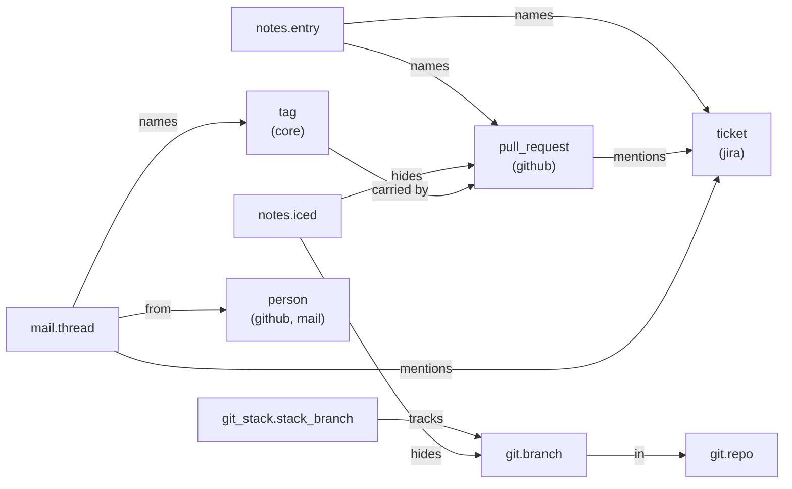
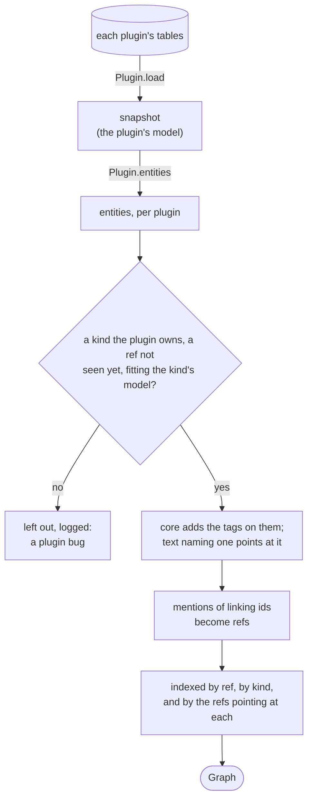
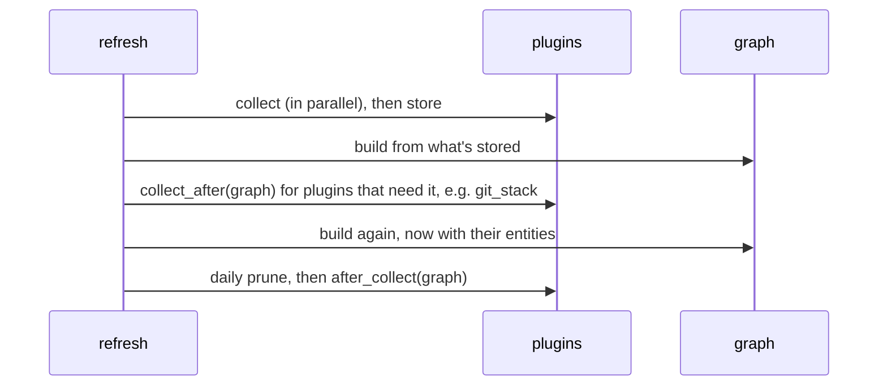
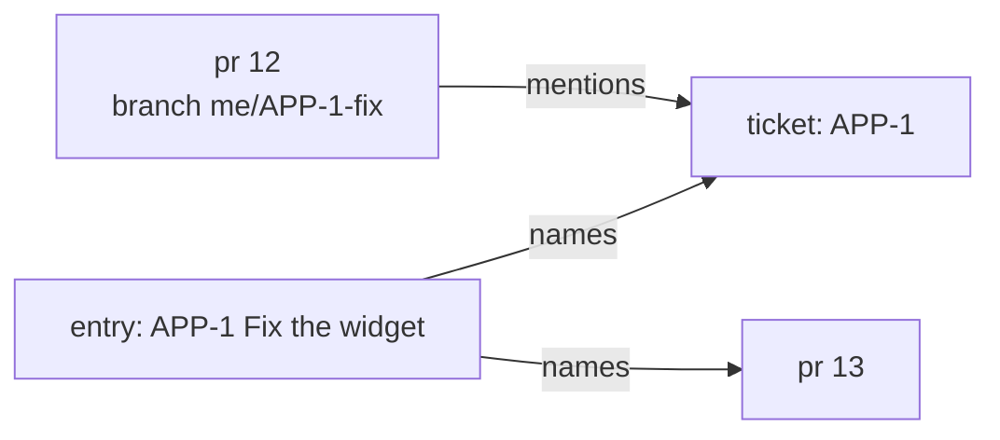

# The entity graph

Plugins never import each other or read each other's config, snapshots or tables. What one
plugin knows that another needs goes through the graph: each plugin publishes **entities**
(PRs, branches, tickets, work entries, ...), and every plugin reads the others' from it.
This page is about how the graph works; [entities.md](entities.md) is the contract, kind by
kind, and [plugins.md](plugins.md) draws who publishes and reads what.

The graph lives in memory and is never stored. Core builds it from what the plugins have
kept in their tables, whenever it's needed: for every page load, button, plugin page and
`mfd <plugin>` command, and twice during a refresh. Building it is cheap: no network, only
the plugins' own tables.

## Entities and refs

An entity is named by a **ref**: a kind and an id within it (a PR's URL, `<repo dir>\t<branch>`,
a ticket's URL). A plugin's own kinds are named for it (`git.branch`, `notes.entry`); a
family's (`pull_request`, `ticket`, `person`, modeled in core, or one a plugin declares) are named for the family,
whoever publishes them, and core sets the entity's `kind` to the publisher's
(`github.pull_request`). Besides its ref it has a title, an
optional URL and state, the refs it points at, and attributes:

```python
class Entity(Model):
    ref: Ref  # e.g. Ref(kind="pull_request", id="https://github.com/acme/widgets/pull/12")
    title: str
    url: str | None
    state: str | None  # "open", "merged", a ticket's status, ...
    refs: list[Ref]  # what it points at
    mentions: list[str]  # text that may name linking entities, see below
    mentions_hide: bool  # whether what they name can hide it; see hidden entities
    attrs: dict[str, JsonValue]
    tags: list[str]  # tags its tool puts on it, e.g. labels: see move_forward.tags
```

Refs are how entities relate. They can point at an entity no plugin publishes (a ticket
key when Jira isn't set up, a branch git has deleted); the ref still links what names it.
Today's kinds and the refs between them:



`notes.iced` hides what it points at; see [hidden entities](#hidden-entities). Slack reads
people's emails, and core joins the people with the same email (`same_person`) and ranks what
points at them by their contact type, or by the importance a tool states for them.

## How it's built



1. Each enabled plugin's `load` reads what its last refresh kept, and its `entities` turns
   that (and its other tables) into entities.
2. A plugin declares the kinds it publishes in `kinds`, each with a model of its
   attributes, and builds its entities' attributes from those models (with `attrs` from
   `move_forward.graph`). A plugin owns the kinds it declares (the first plugin to declare
   one, should two), and only it publishes them, each ref once. Core checks every entity
   for that and against its kind's model; one that fails is left out and logged, so the
   page goes on without it.
3. Core adds a `tag` per `#tag` in a title or mentions (or put on by hand), pointing at what carries
   it, and points each entity whose title or mentions name one at it (see `move_forward.tags`).
4. Text an entity `mentions` that matches a linking kind's id pattern becomes a ref to it
   (see [related entities](#related-entities)).
5. The graph indexes entities by ref, by kind, and by the refs pointing at each, for the
   lookups below.

During a refresh the graph is built twice:



`mfd serve` also builds it from what's stored for each round of change checks (`changed`),
and keeps the one each plugin's last check was given (unless that check raised), to give it
to the next as `previous_graph`. A plugin that `watches` another compares the two to see
what that one's refresh moved: github sees a branch of one of my PRs move from git's
`git.branch` entities, without keeping where they stood itself. The first check since the
server started has none to compare with.

## Reading it

```python
graph.get("pull_request", url)  # one entity, or None
graph.of_kind("pull_request")  # every publisher's PRs; "github.pull_request" for github's
graph.related(ref, "notes.entry")  # see below
graph.units(ref)  # the linking entities it's part of, see below
graph.named("APP-1: fix it")  # the linking entities a text names, see below
graph.hidden(ref)  # whether something on ice covers it, see below
graph.url_for("ticket", "APP-1")  # jira makes it from the key
graph.handle("ticket", url)  # what to call it: "APP-1"
graph.identify("ticket", "APP-1")  # the id for a key kept before ids were URLs
graph.same_person("github.com/alice")  # the `person`s with their email, whoever publishes them
```

### Through a view

A consumer doesn't read `entity.attrs` directly. It declares the fields it uses as a small
model of its own, a **view**, and reads entities through it:

```python
class _PrView(Model):
    """What jira reads of a `pull_request`."""

    id: str
    url: str | None = None
    state: str | None = None
    number: int
    draft: bool
    mine: bool


for pr in graph.view_related(ticket_ref, PULL_REQUEST, _PrView):
    if pr.mine and not pr.draft:
        ...
```

`view(kind, View)`, `view_one(kind, id, View)` and `view_related(ref, kind, View)` validate
each entity's `id`, `title`, `url`, `state` and attributes against the view. If a publisher
renames or drops an attribute a consumer relies on, the view raises, and the consumer's
tests fail, instead of `attrs.get` quietly giving `None` and the page quietly showing less.
A view lists only what its consumer reads, so publishers can add attributes freely.

### Related entities

Text names a family's entities by their `handle` (a ticket's key): a pattern's match is
looked up among the entities with that handle (`graph.by_handle(kind, handle)`), all of
them when two trackers share a key; a match no entity has yet becomes a ref with the id its
plugin's `url_for` gives it (a ticket's URL, from its key), else with that text as its id.

Some kinds stand for a unit of work and link what's about it. A plugin declares them with
`KindSpec(..., linking=True)`, and gives the pattern of its ids, if text can name them, in its
`linking_patterns` hook (from what it has seen, as jira does with the project keys it knows):

```python
class JiraPlugin(Plugin[JiraConfig]):
    kinds = {TICKET: KindSpec(JiraTicket, linking=True)}

    def linking_patterns(self, req):  # keys of the projects my tickets have been in
        return {TICKET: key_pattern(IssueRepository(req.ctx.db).projects())}


class NotesPlugin(Plugin[NotesConfig]):
    kinds = {"notes.entry": KindSpec(EntryAttrs, linking=True)}  # it points at what it links
```

Core adds a kind of its own, `tag` (see `move_forward.tags`): one per `#tag` in an entity's
title or mentions (out of code), or put on it by hand, pointing at what carries it, while each entity whose title or mentions name a tag points
at it. It isn't linking, so it relates nothing through it: `related(ref, "tag")` gives the tags
on or named by `ref`, and by the tickets or entries it belongs to (one hop through a linking
entity, as for any kind), and a tag's `refs` what carries it. A one-word tag shorter than
three letters is named only with its `#`.

`related(ref, kind)` finds entities of `kind` one hop from `ref`, in either direction, or
linked with it by a linking entity that's one hop from both:



Here `related(entry, "pull_request")` is PR 13 (the entry names it) and PR 12 (the ticket
links them), `related(pr12, "notes.entry")` is the entry, and `related(ticket,
"pull_request")` is PR 12 and PR 13 (the entry links them). It goes one link deep:
`related(pr12, "pull_request")` is nothing,
since PR 13 is two links away, through the ticket and then the entry. Core knows no
linking kind by name; a Linear or GitHub issue would join in by declaring its kind.

`units(ref)` is the linking entities themselves: those `ref` points at, mentions or is
pointed at by, and `ref` if it's one. Here `units(pr12)` is the ticket, `units(pr13)` the
entry, and `units(ticket)` the entry and the ticket. Act now merges an item about a unit
(moving the ticket) into an item about something in it (PR 12) this way.

A linking kind with a pattern is found in **mentions**: text an entity carries that may
name one, like a PR's branch, title and body. Building the graph, core adds a ref from the
entity to each linking entity whose id its mentions match, whether or not that entity is
in the graph, so the publisher needn't know the kind. Without the plugin that declares
the pattern (Jira not set up), mentions link nothing. `graph.named(text)` finds the same
refs in any text, for a plugin reading text of its own (notes finds the tickets a todo
names with it).

### Relations

Some links only a third plugin knows: which local branch a pull request comes from is in
neither github's PR (its head's name, in a repo on GitHub) nor git's branch (a name, in a
checkout) alone. A plugin says what it knows with `relate(req)`: pairs of one of its own
entities and another's, which core adds as refs from the first to the second after every
plugin has published, so `graph.related(branch, "pull_request")` finds the branch's PRs
whoever relates them. github relates each PR to the branch of its head's name in the
checkout of its repo; else, for a branch renamed since it was pushed, the one whose
upstream has that name; else, for one of mine, a branch at its head's commit. git, git_stack,
notes and github's push tracking all read that one relation, so a second code host's
plugin relates its own PRs and they work everywhere. A relation from an entity that isn't
the plugin's is logged and left out.

### Hidden entities

A plugin can declare kinds whose entities **hide** what they point at, with
`KindSpec(..., hides=True)`. notes'
`notes.iced` is one: what's on ice stays off the page until it's thawed. It points at what's on
ice (a stack's branches, a PR, a ticket or a work entry) and at what notes finds for it
after each refresh: the branches' PRs and git_stack's `git_stack.stack_branch`es, and what an iced
entry points at.
`graph.hidden(ref)` says whether a hiding entity covers `ref`, directly or through a
linking entity next to it: icing a ticket hides the PRs that mention it, icing a work entry
hides the PRs it names. It doesn't go the other way: icing a PR leaves its ticket alone. A
ticket found only in text someone else wrote hides nothing: an entity with
`mentions_hide=False` (a PR I'm asked to review, a mail thread) is hidden only through refs
its plugin gave it. Only hiding is held back: what its text names is still linked to it, and a
priority on that still ranks it.

Core, building the page, leaves out of every panel (and so of Act now and focus mode) each
item with a hidden subject. Items about the hiding entity itself, like an On ice panel's,
stay. So plugins never check for ice themselves.

### URLs, and entities not in the graph

`url_for(kind, id)` gives an entity's URL from the graph, else asks the plugins: github
answers for any PR URL, jira makes a ticket's link from its key alone. `handle(kind, id)`
gives what to call it the same way: its `handle` from the graph, else the plugins'
`handle_for` (jira's: a ticket's key from its URL), else the id.

`identify(kind, id)` gives the id an entity of a family has, for an id kept before the
family's ids were what they are: a ticket kept by its key gets the ticket with that handle,
or else the URL jira makes. Core and notes run what they keep through it at each refresh.

`fetch(kind, ids)` asks the plugin that owns a kind to fetch entities now, from its tool,
even ones long gone from its tables: notes' daily prune asks when old PRs closed and tickets
were resolved. It's slow, so it's only for work that runs rarely; a plugin that fails is
left out, and what it would have answered counts as unknown.

## Rules

- A plugin publishes only its own kinds, declares them in `kinds`, and documents them in
  [entities.md](entities.md) in the same commit as the change.
- Plugins read each other only through the graph, through views.
- Panels are pure: they read the graph and the plugin's own snapshot, nothing slow. Work
  that needs the network happens in `collect`, `collect_after`, `after_collect` or (rarely)
  through `fetch`.
