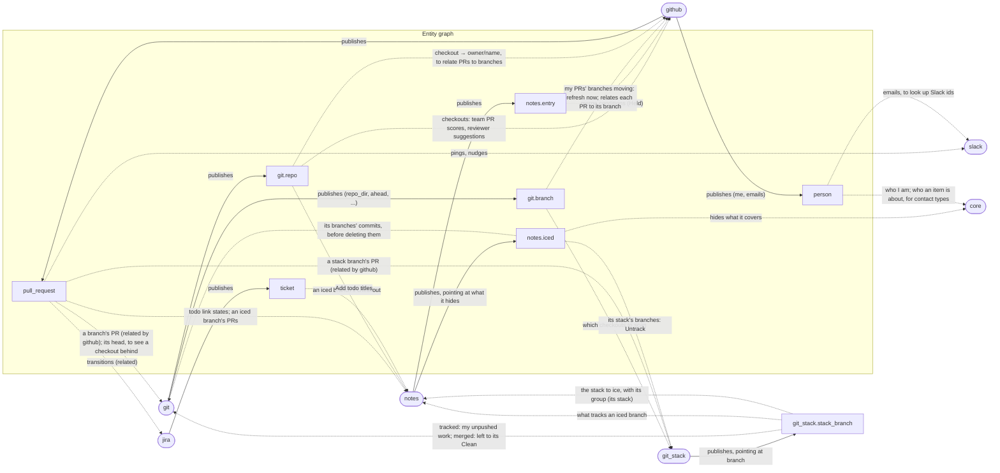
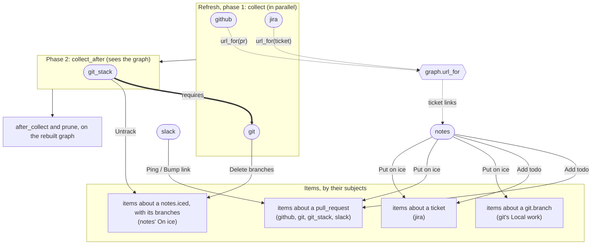

# How the plugins interact

Plugins never import or call each other. Each one publishes entities to the graph and
reads what the others publish; [graph.md](graph.md) explains the graph, and
[entities.md](entities.md) lists every kind and attribute. Each plugin has a page of
its own: [github](plugins/github.md), [git](plugins/git.md),
[git_stack](plugins/git_stack.md), [jira](plugins/jira.md), [slack](plugins/slack.md)
and [notes](plugins/notes.md).
These diagrams show who publishes and who reads what. Keep them in step with the code: a
change to what a plugin publishes or reads, to its item actions or to its `requires`
updates this file in the same commit.

git and git_stack both nominate merged branches for Act now, each those it can clean up: git leaves
the ones git-stack tracks to git_stack's Clean.

Core adds importance choices to entity items and their individual todo parts (but not to
items about what hides things), and a Snooze to the items of a `snoozable` panel. Plugins can group their buttons with those of other plugins: notes' Put on ice joins git's
Delete under Disposition, and joins core's Snooze, Dismiss and Pin on Act now items.
Emoji buttons retain their text labels in titles and accessible names.

## Entities

Solid arrows publish, dashed arrows read.

## Refresh, requirements and item actions

Plugins collect in two phases: `collect` first, in parallel, then `collect_after` for
plugins that need the others' entities to know what to fetch. A plugin's `requires` must
be enabled too; one that collects after the graph is refreshed with them, unless it
`watches` them, when its `changed` decides. Plugins add buttons to each other's items by the items' `subjects`.

slack and notes have no snapshot, so they don't collect.

The daily prune is the one place a plugin reaches past the graph built from snapshots:
notes asks `graph.fetch` when old PRs closed (github) and tickets resolved (jira), to know
which entries are finished.
