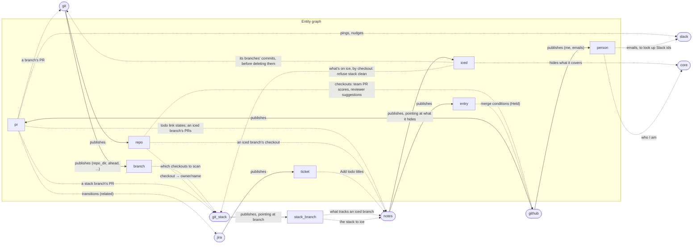
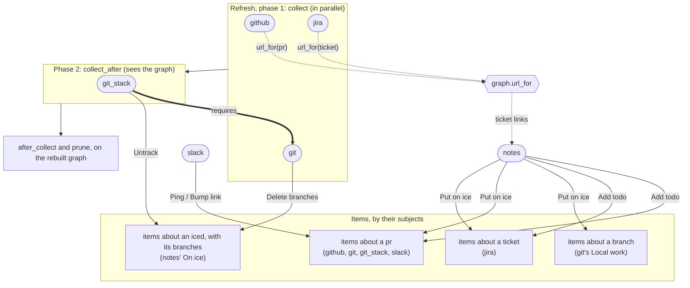

# How the plugins interact

Plugins never import or call each other. Each one publishes entities to the graph and
reads what the others publish; [graph.md](graph.md) explains the graph, and
[entities.md](entities.md) lists every kind and attribute.
These diagrams show who publishes and who reads what. Keep them in step with the code: a
change to what a plugin publishes or reads, to its item actions or to its `requires`
updates this file in the same commit.

## Entities

Solid arrows publish, dashed arrows read.

## Refresh, requirements and item actions

Plugins collect in two phases: `collect` first, in parallel, then `collect_after` for
plugins that need the others' entities to know what to fetch. A plugin's `requires` must
be enabled too. Plugins add buttons to each other's items by the items' `subjects`.

slack and notes have no snapshot, so they don't collect.

The daily prune is the one place a plugin reaches past the graph built from snapshots:
notes asks `graph.fetch` when old PRs closed (github) and tickets resolved (jira), to know
which entries are finished.
